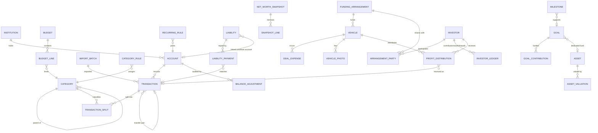

# Dreamboard: Architecture, Screen Map, Design System, Data Model and Plan

Dreamboard is a private, offline-first personal finance app for Android. It is built only from free, open-source parts and needs no server, account, API key or subscription.

---

## 1. Application architecture

**Stack:** Kotlin 2.0 · Jetpack Compose + Material 3 · MVVM with Clean Architecture layers · Hilt · Navigation Compose · Coroutines/Flow · DataStore. Charts are custom Compose Canvas, so there is no chart dependency. Room, WorkManager, BiometricPrompt and the Storage Access Framework arrive in later phases (section 5). Minimum SDK 26 (Android 8.0), target and compile SDK 35.

```
┌──────────────────────── UI layer (feature/*) ────────────────────────┐
│ Compose screens  ←  StateFlow<UiState>  ←  @HiltViewModel ViewModels  │
└──────────────────────────────┬───────────────────────────────────────┘
                               │ depends on interfaces only
┌──────────────────────── Domain layer ────────────────────────────────┐
│ domain/model      pure Kotlin entities (Asset, Debt, Transaction, …) │
│ domain/repository FinanceRepository interface                        │
│ core/finance      LoanMath, GoalMath, IgniteMath (pure, unit-tested) │
│ core/money        Long minor units, basis points, MoneyFormatter     │
└──────────────────────────────┬───────────────────────────────────────┘
                               │ bound by Hilt (di/AppModule)
┌──────────────────────── Data layer ──────────────────────────────────┐
│ Phase 1: data/demo/DemoFinanceRepository (labelled demo data)        │
│ Phase 2: data/local Room DAOs + RoomFinanceRepository (same API)     │
│ data/prefs: UserPreferencesRepository (DataStore)                    │
└──────────────────────────────────────────────────────────────────────┘
```

Key decisions:

- **Money is never floating point.** Every amount is a `Long` in minor units (cents). Rates and shares are integer basis points. Projections use `BigDecimal` with explicit rounding (half-up, to the cent). Double is used only to draw chart pixels.
- **One repository interface.** Screens and ViewModels depend on `FinanceRepository`. Phase 2 swaps the Hilt binding from the demo implementation to Room; no UI code changes.
- **Pure finance engines.** `LoanMath`, `GoalMath` and `IgniteMath` have no Android dependencies, so they are unit-tested on the JVM.
- **Accounting rules live in the model.** `TransactionType.countsAsSpending` and `countsAsIncome` decide what hits the budget, so transfers, card-bill payments and loan principal can never be double-counted.
- **Privacy by default.** No `INTERNET` permission, Android auto-backup and device transfer excluded, `FLAG_SECURE` on by default, privacy mode masks every amount through a single `MoneyText`/`formatMoney` path.

### Package layout

```
com.dreamboard.app
├── DreamboardApplication.kt, MainActivity.kt
├── core/
│   ├── money/          Money.kt (kes, bps helpers), MoneyFormatter.kt
│   ├── finance/        LoanMath.kt, GoalMath.kt, IgniteMath.kt
│   └── designsystem/
│       ├── theme/      Color.kt, Type.kt, Theme.kt (DbTheme.colors)
│       ├── component/  Cards, Chrome (headers, chips, banners), MoneyText, Progress
│       └── chart/      LineAreaChart, DonutChart, GroupedBarChart, StackedBar
├── domain/model/       Wealth.kt, Debt.kt, Budget.kt, Ignite.kt
├── domain/repository/  FinanceRepository.kt
├── data/demo/          DemoFinanceRepository.kt
├── data/prefs/         UserPreferencesRepository.kt
├── di/                 AppModule.kt
├── navigation/         TopLevelDestination.kt, DreamboardAppUi.kt
└── feature/
    ├── dreamboard/     DreamboardScreen, PorscheGoalScreen, SuvIllustration, ViewModel
    ├── debt/           DebtScreen, DebtDetailScreen, ViewModels
    ├── budget/         BudgetScreen, BudgetCategoryScreen, ViewModels
    ├── ignite/         IgniteScreen, VehicleDetailScreen, ViewModels
    └── settings/       SettingsScreen, SettingsViewModel
```

---

## 2. Screen map

Bottom navigation (always visible): **Dreamboard · Debt · Budget · Ignite**. Every primary screen has a privacy (eye) toggle and a settings icon at the top right.

```
Dreamboard (tab 1, start)
├── Net worth hero: total, 30-day change, assets, liabilities
├── Net-worth history chart: 1M · 3M · 6M · 1Y · 5Y · All, tap/drag to inspect
├── Asset allocation donut: tap a class to list its assets (actual vs estimate tags)
├── Porsche Cayenne card ─────────────► Porsche Dream Tracker
│                                        ├── 1 · Fund progress (fund only, inflation-adjusted)
│                                        ├── 2 · Readiness checks (debt, buffer, funding, running costs)
│                                        ├── Ownership cost estimate
│                                        └── Editable assumptions (sliders)
└── Milestones journey (2027 → 2035) ──► Edit milestone dialog

Debt Position (tab 2)
├── Total outstanding + debt-free countdown
├── Interest-bearing total, monthly commitments
├── Projected debt reduction chart + principal vs interest
├── Strategy engine: Avalanche · Snowball · Custom, extra payment, Ignite income to debt
├── Debt composition
└── Lender list ──────────────────────► Debt detail
                                         ├── Terms, rate, installment, due day
                                         ├── Early repayment scenario + balance forecast
                                         └── Repayment history

Budget & Expenses (tab 3)
├── Remaining budget, % used, variance, projected month-end
├── Overspending alerts ──────────────► Category detail
├── Income, cash-flow surplus, cash commitments (not spending)
├── Budget vs actual (6 months)
├── Category bars ────────────────────► Category detail (limit, remaining, transactions)
├── Top merchants & recipients
└── Transactions: search + filter (spending / income / transfers & repayments)

Ignite (tab 4)
├── Net profit, personal earnings, gross profit
├── KPI grid: stock, capital deployed, business cash, revenue, sales, avg profit,
│   days to sell, return on capital, inventory turnover
├── Monthly net profit vs target + projected profit on stock
├── Inventory (In stock · Sold · Pipeline · All) ► Vehicle detail
│                                                 ├── Deal economics and expenses
│                                                 ├── Profit sharing for its arrangement
│                                                 └── Details, days in stock
├── Profit by investor pool
└── Deal ranking + profit by model

Settings (top-right icon, any tab)
├── Privacy mode, screenshot protection, biometric lock (Phase 5)
├── Abbreviated amounts, theme (Dark · Light · System), currency
├── Imports and encrypted backups (Phase 5, shown as information only)
└── How your data is protected (device-only storage trade-offs)
```

---

## 3. Visual design system

**Direction:** quiet luxury. Midnight surfaces, warm ivory type, a single champagne-gold accent used sparingly for the selected tab, key figures and progress. No neon, no heavy gradients; the only gradients are soft fills under chart lines and the SUV illustration's floor glow.

| Token | Dark (default) | Light | Use |
|---|---|---|---|
| background | `#0B1018` midnight | `#F7F4EC` paper | App background |
| surface | `#182131` navy charcoal | `#FFFFFF` | Cards |
| surfaceRaised | `#1E293B` | `#EFEADF` | Card headers, icon tiles |
| hairline | `#263247` | `#E2DBCC` | 1dp card borders, chart grid |
| onSurface | `#F6F3EB` ivory | `#0B1018` | Primary text |
| textMuted | `#A8B3C2` slate | `#55606F` | Secondary text |
| gold | `#C7A878` champagne | `#8C6B38` | Accent, selection, progress |
| positive | `#80CBA6` emerald | `#2F7A57` | Gains, assets, payoff |
| negative | `#E9A09B` coral | `#B4524B` | Losses, liabilities, overspend |

The light palette darkens accent colours so text on ivory stays above WCAG AA contrast.

**Typography** uses system fonts only (works offline): serif for hero figures and headings (`displayLarge` 44sp for net worth), platform sans for everything else, small caps-style tracked overlines (`labelSmall`, 1.4sp tracking) for card labels. All figure styles use tabular numerals (`tnum`) so amounts align. Sizes are in `sp`, so they follow the phone's font-size setting.

**Shape and spacing:** cards 24dp radius, chips/inputs 12–18dp. 20dp screen gutters, 14dp between cards, 16–24dp inside cards. Cards use a 1dp hairline border instead of heavy shadows in dark mode (1dp shadow in light mode).

**Components:** `DbCard`, `KpiCard`, `StatCard`, `MoneyText` (privacy-aware, animated), `ChangePill`, `ProgressRing`, `SlimProgress`, `ScreenHeader`, `SectionHeader`, `DemoDataBanner`, `Tag`, `ChoiceChips`, `EmptyState`, `InfoRow`/`MoneyInfoRow`.

**Charts (Canvas):** `LineAreaChart` (smoothed line, soft area fill, reveal animation, tap/drag inspection, dashed segments for forecasts), `DonutChart` (animated sweep, tap to select), `GroupedBarChart` (actual vs budget ghost bars, dashed targets, tap to select), `StackedBar` (composition).

**Motion:** 900–1100ms ease-out reveals for charts and rings, cross-fades on changing figures, 200ms fades between screens. Nothing loops.

**Imagery:** the Cayenne card uses an original line-art SUV drawn in code. No manufacturer photos or marks are used; a user-supplied photo can replace it later.

---

## 4. Database entity relationship model (Room, Phase 2+)

All amounts are `INTEGER` minor units; rates and shares are `INTEGER` basis points. Every table has `id` (TEXT UUID primary key), `created_at`, `updated_at` (epoch millis) and, where data can be imported, `source` and `source_ref` for traceability. Value-bearing rows carry `value_type` (ACTUAL, ESTIMATED, FORECAST).



| Entity | Key columns (besides id and timestamps) | Indexes |
|---|---|---|
| institution | name, type (BANK, SACCO, MOBILE_MONEY, OTHER) | name |
| account | institution_id FK, name, kind (CURRENT, SAVINGS, MOBILE_MONEY, CREDIT_CARD, LOAN, INVESTMENT, CASH), currency, opening_balance_minor, opening_date, is_business | institution_id |
| transaction | account_id FK, date, amount_minor (signed), type (INCOME, EXPENSE, TRANSFER, CARD_PAYMENT, LOAN_PRINCIPAL, INTEREST, INVESTMENT, BUSINESS_CAPITAL, REFUND, REIMBURSEMENT), merchant, note, transfer_pair_id FK, import_batch_id FK, dedupe_hash UNIQUE, source | (account_id, date), dedupe_hash, merchant |
| transaction_split | transaction_id FK, category_id FK, amount_minor | transaction_id, category_id |
| category | parent_id FK, name, is_archived | parent_id |
| category_rule | match_field, pattern, category_id FK, priority | priority |
| import_batch | file_name, file_hash, format (CSV, XLSX, MPESA_PDF), row_count, error_report | file_hash |
| balance_adjustment | account_id FK, date, amount_minor, reason (audit trail) | account_id |
| budget | month (YYYY-MM) or year, kind (MONTHLY, ANNUAL) | month UNIQUE per kind |
| budget_line | budget_id FK, category_id FK, limit_minor | (budget_id, category_id) UNIQUE |
| recurring_rule | account_id FK, template fields, rrule, next_date | next_date |
| asset | category, name, institution, linked_account_id FK, is_goal_fund | category |
| asset_valuation | asset_id FK, date, value_minor, value_type | (asset_id, date) |
| liability | category, kind (REDUCING_BALANCE, REVOLVING, STATEMENT_PAID_IN_FULL, INTEREST_FREE), lender, original_principal_minor, annual_rate_bps, installment_minor, due_day, start_date, term_months, custom_priority, linked_account_id FK | category |
| liability_payment | liability_id FK, date, amount_minor, principal_minor, interest_minor, transaction_id FK | (liability_id, date) |
| net_worth_snapshot | date, assets_minor, liabilities_minor, is_verified | date UNIQUE |
| snapshot_line | snapshot_id FK, ref_type, ref_id, value_minor | snapshot_id |
| goal | name, target_date, today_price_minor, return_bps, inflation_bps, insurance_bps, maintenance_minor, fuel_minor, fund_asset_id FK | — |
| goal_contribution | goal_id FK, date, amount_minor, transaction_id FK | goal_id |
| milestone | year, title, description, status, goal_id FK | year |
| investor | name, type (UK_POOL, INDIVIDUAL, PARTNER) | — |
| investor_ledger | investor_id FK, date, kind (CONTRIBUTION, WITHDRAWAL), amount_minor | (investor_id, date) |
| funding_arrangement | name, type, investor_share_bps, partner_share_bps, personal_share_bps (CHECK sum = 10000) | — |
| arrangement_party | arrangement_id FK, investor_id FK, share_bps | arrangement_id |
| vehicle | registration, make, model, year, purchase_date, purchase_price_minor, arrangement_id FK, condition, listing/expected/actual price, sale_date, status, notes | status, registration, arrangement_id |
| deal_expense | vehicle_id FK, kind, amount_minor, date, note | vehicle_id |
| vehicle_photo | vehicle_id FK, uri (app-private file) | vehicle_id |
| profit_distribution | vehicle_id FK, investor_id FK (null = personal), amount_minor, date, received_transaction_id FK | vehicle_id, investor_id |

Rules enforced in the data layer:

- Transfers are stored as linked pairs with type TRANSFER and never count as income or spending.
- Card purchases are EXPENSE on the card account. The bill payment is CARD_PAYMENT, paired with the bank debit, and never counts as spending.
- Loan installments are split into LOAN_PRINCIPAL (reduces the liability) and INTEREST (an expense).
- Personal net worth includes only `asset` rows (including your own Ignite equity) minus `liability` rows. Investor capital lives only in `investor_ledger` and never enters personal totals.
- Personal Ignite earnings reach cash flow only through a `profit_distribution` linked to a received INCOME transaction, so entitlement and cash are not double-counted.
- Schema changes ship as Room `Migration` objects with exported schemas and migration tests. Destructive fallback is disabled.

---

## 5. Phased implementation plan

| Phase | Scope | Status |
|---|---|---|
| **1 · Design system & navigation** | Project, theme, typography, components, Canvas charts, four-tab navigation with nested detail screens, settings (privacy mode, abbreviation, screenshot protection, theme stored in DataStore), finance engines with unit tests, clearly labelled demo data | Done |
| **2 · Local database** | Room schema with exported schema and a migration list, accounts with opening balances, assets with valuation history, liabilities with payment history (interest split from principal) and an audit trail of balance changes, manual transaction entry and editing with category splits, category limits, month browsing, persisted goal/milestone edits, real net-worth totals, weekly snapshots (WorkManager plus app start) and manual snapshots. Brought forward from Phase 5: CSV/XLSX import with sheet picker, header detection, editable column mapping, duplicate detection and import error reports | **This delivery** |
| 3 · Debt & budget engines | Per-loan amortisation from start dates, irregular repayments, revolving-card modelling, custom priority editor, monthly and annual budgets, copy budget to month, category/subcategory management, splits, rules, recurring transactions, budget alerts and due-date notifications (local) | |
| 4 · Ignite module | Vehicle CRUD with photos, deal expenses, investors and ledgers, configurable arrangements, distributions, personal-income attribution, analytics, spreadsheet import of history | |
| 5 · Imports, backups, QA | Import refinements (saved column mappings per sheet, M-Pesa PDF statements where reliable, bulk reclassification), encrypted backup/restore (AES-GCM key in Android Keystore plus user passphrase), Drive via the system file picker, BiometricPrompt lock, UI and migration tests, performance | |

---

## 6. Assumptions (documented, all editable later)

- Currency KES only in Phase 1; the formatter takes a currency code for later multi-currency support.
- Debt balances are the user's example figures used as seed data. Rates, installments, due days, original principals and interest paid to date are illustrative assumptions: ABSA personal loan 16.5% p.a., KES 42,000/month; SACCO 12% p.a. (1%/month reducing); ABSA card 36% p.a. revolving with KES 12,000/month; family obligation interest-free at KES 10,000/month.
- Equity credit card is modelled as a statement balance settled in full monthly: it counts as a current liability but is excluded from payoff strategies, and its purchases already count as spending.
- Salary advance balance is unknown. It is shown as "Not entered" and excluded from all totals until entered.
- Interest is computed monthly on the reducing balance (rate ÷ 12). Real lenders may use daily accrual or fees, so projections are labelled as estimates.
- Porsche goal: KES 22M price today, 5% vehicle-price inflation (including FX), 9% expected return, KES 350,000 already in a dedicated fund, KES 25,000/month contribution, purchase by December 2035, insurance 4.5% of value, KES 400k service and KES 540k fuel per year. All are sliders on the tracker screen.
- Readiness is a separate test: interest-bearing debt cleared, 6+ months of liquid buffer (excluding the Porsche fund), fund fully funded, and running costs at or below 10% of take-home income.
- Net-worth history in Phase 1 is a synthetic demo curve, marked as demo. From Phase 2, history comes only from verified snapshots; with no history, the chart shows an empty state rather than invented data.
- Ignite demo vehicles use "DEMO 00x" registrations. Profit-sharing percentages are per arrangement (joint pool 50/50 partner/you; UK pool 60/20/20; individual investor 50/25/25; partner-funded 70/30) and are placeholders.
- From Phase 2 the app starts empty apart from settings-like defaults: 14 budget categories with limits, a "Bank account" and an "M-Pesa" account, the four milestones and the Porsche goal assumptions. Frank's example debts are loaded only on request (Debt tab or Settings) and labelled as unverified starting values.
- Ignite still shows labelled demo data until Phase 4.
- Snapshots: one per date. An automatic snapshot is saved when the last one is 7 or more days old and there is data; "Record snapshot now" saves one on demand. History is never back-filled.
- Account balances are informational (opening balance plus transactions since the opening date). Net worth counts assets and liabilities only, so a bank balance must be entered as an asset to count; this avoids double counting.
- Imports: rows become Expense (money out) or Income (money in), and the user reclassifies transfers, card bill payments and loan repayments afterwards. Duplicates are matched on account, date, signed amount and normalised description, counted as a multiset so genuine repeat purchases in one file are kept. A sheet category that doesn't exist is created with no limit. The XLSX reader is a small built-in zip + SAX parser hardened against XML external entities; old .xls files are refused with advice to save as .xlsx or .csv. Files are read on the phone only.
- Biometric lock and backups are shown in Settings as planned items with their phase, not as buttons, so nothing looks functional without being so.
